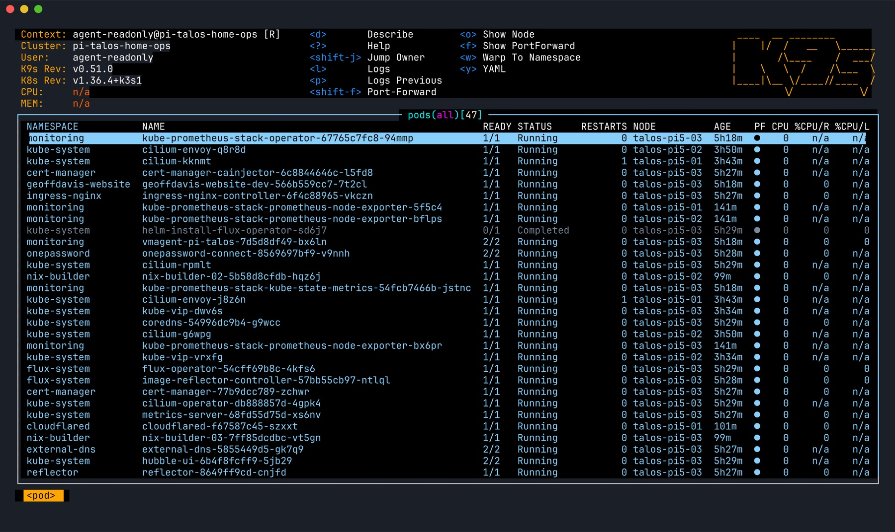

+++
date = '2026-10-28T00:00:00-07:00'
title = 'Leaving Talos for NixOS and k3s on a Raspberry Pi 5 Cluster'
description = "Why my three-node Raspberry Pi 5 Kubernetes cluster moved off Talos Linux to NixOS and k3s: the kernel that had both fixes I needed, a cluster that now bootstraps itself from k3s's manifests directory, and the traps along the way, from a floating serial pin that halts U-Boot to a DHCP option that quietly rerouted traffic."
tags = ['raspberry-pi', 'nixos', 'k3s', 'talos', 'kubernetes', 'linux', 'homelab', 'flux', 'cilium']
draft = false
hero = "hero.svg"

[cover]
image = "hero.svg"
alt = "Illustration: a Raspberry Pi 5 on Talos with a USB Ethernet dongle and an idle fan, then the same board on NixOS + k3s using its built-in Ethernet with the fan running"
+++

Back in March I wrote about [silent network death on the Raspberry Pi 5](/posts/rpi5-eee-silent-network-death/). The built-in Ethernet hangs because of Energy Efficient Ethernet. The follow-up was about [routing around it with USB 2.5GbE dongles](/posts/rpi5-usb-ethernet-bypass/). Both posts were about keeping a Talos Linux cluster alive on hardware its kernel didn't fully support.

This post is about the day I stopped doing that. The three Pi 5 nodes now run NixOS with k3s on the Raspberry Pi vendor kernel. Cluster traffic is back on the built-in NIC and the dongles are in a drawer. Talos is gone from the repository.

**TL;DR**:

- Talos ships mainline-based kernels. The Pi 5 needed two things no single Talos release had together: the PHY fix that makes the built-in `end0` NIC reliable, and a driver for the Active Cooler fan.
- The Raspberry Pi vendor kernel (`linux-rpi`) has both. Another Pi 5 in my fleet had already run it on NixOS for twelve days with no TX stalls.
- The new cluster is three k3s servers with embedded etcd, Cilium, kube-vip and Flux. All of it is declared in Nix. A node with a wiped k3s state directory rebuilds the cluster with no hand-run steps.
- The planning, install, cutover and cleanup all happened on one day. That was possible because the board config, the secrets workflow and the deploy tooling already existed and had been proven elsewhere in the fleet.
- The traps were mostly in the boot path and the network, not in Kubernetes.

## Why Talos had to go

I liked Talos. An immutable, API-driven OS for Kubernetes nodes is a good idea, and it served this cluster for about seven months. The problem was the kernel.

### The NIC

The Pi 5's built-in Ethernet goes through the RP1 southbridge and the `macb` driver to a Broadcom PHY. The PHY's autonomous EEE mode, AutogrEEEn, stalls transmit. Talos picked up the `macb` TX-stall watchdog patches, so stalls healed in about a second. They still happened, though. On Talos v1.13.8 one node logged at least six stalls in about nineteen hours on near-idle management traffic. Each stall on the cluster interface meant a VIP move and an etcd leader election, which is why cluster traffic had been on USB dongles since March.

The dongles worked, but they had costs. The RTL8156 adapters come up as a fake CD-ROM after every cold boot, so each node carried a three-layer mode-switch workaround. They also strained the USB ports. One node's USB-attached cluster link kept flapping, which I put down to damaged ports.

I checked again in October whether a newer Talos kernel would let the dongles go:

- **Talos 1.14.5** backports the `macb` EEE patches. It lacks the PHY fix that turns AutogrEEEn off, and my March testing had shown that was the patch that mattered.
- **Talos 1.15** (kernel 7.3) is the first release with both. It still has no Active Cooler fan driver.

### The fan

The Pi 5's Active Cooler is driven by a PWM controller on the RP1. Mainline Linux has no driver for it. The device tree is correct and `pwm-fan` is built in, but the fan driver waits forever for a PWM provider that never registers. A fanless Pi 5 idled at 68–75 °C on my cluster and peaked past the 85 °C throttle point.

In August I built a custom Talos kernel that carried the downstream driver, deployed it to the spare GRUB slot, and [sent it upstream](https://github.com/siderolabs/pkgs/pull/1655). Sidero declined, which was reasonable: they don't carry non-mainline patches. They said they'd take a backport once the mainline driver reaches linux-next. The mainline series was at v12 by late September and still unmerged. So Talos 1.15 doesn't get fan control for free, contrary to what I'd hoped in August. Every Talos upgrade would wipe my slot-B kernel and I'd have to build it again.

### The decision

Staying on Talos meant carrying a custom kernel indefinitely, for at least one of the two fixes, on every upgrade. The vendor kernel has both. I also had evidence instead of a theory: `torrey`, a Pi 5 that already runs NixOS on `linux-rpi`, had gone twelve days with zero TX stalls on the same hardware.

Once the kernel was the deciding factor, the obvious move was to put the cluster on the OS that already ran that kernel well.

## What it looks like now


flowchart TD
    subgraph repo["pi-talos-home-ops"]
        nodes["nixos/nodes.nix\n(only per-node facts)"]
        node["nixos/node.nix\nrpi5 board + disko + k3s server"]
        boot["nixos/k3s-bootstrap.nix"]
        kube["kubernetes/\n(Flux tree)"]
    end
    common["nix-common\nnixosModules.rpi5"] --> node
    nodes --> node
    node --> k3s["k3s 1.36 server\nembedded etcd"]
    boot -->|"manifests dir"| k3s
    k3s --> cilium["Cilium\n(HelmChart, bootstrap: true)"]
    k3s --> vip["kube-vip\n(API VIP)"]
    k3s --> flux["flux-operator + FluxInstance\n+ bootstrap Secrets (sops-nix)"]
    flux -->|"syncs"| kube

    classDef src fill:#1f4f8f,stroke:#7eb6ff,color:#ffffff
    classDef shared fill:#5b3a9e,stroke:#b79cff,color:#ffffff
    classDef runtime fill:#2f7d4f,stroke:#8cff9e,color:#ffffff
    classDef addon fill:#9a5b12,stroke:#ffc46b,color:#ffffff
    class nodes,node,boot,kube src
    class common shared
    class k3s runtime
    class cilium,vip,flux addon
    style repo fill:#3b6fd122,stroke:#7eb6ff,stroke-dasharray:4 4,color:#7eb6ff


The cluster repo has its own flake. Its pins follow my shared `nix-common` flake.

**One node table.** `nixos/nodes.nix` holds the only per-node facts: addresses, the NVMe disk's by-id name, and which node bootstraps etcd. The `nixosConfigurations`, the deploy-rs targets and the k3s join topology are all generated from it. Adding a fourth node means one entry there plus its host key in `.sops.yaml`.

**A shared board module.** The Pi 5 boot config (pinned firmware, U-Boot, `linux-rpi`) that `torrey` had proven moved to `nix-common` as `nixosModules.rpi5`. I checked that the move left `torrey`'s closure identical. The cluster pins `nixos-hardware` to the same revision my personal fleet uses, so the cluster kernel is the *same derivation* `torrey` builds. That matters more than it sounds: it substitutes from the binary cache instead of compiling a kernel on a Pi for hours.

**Every node is a k3s server.** It runs embedded etcd, with flannel, kube-proxy, servicelb, Traefik and network policy all off so Cilium can take over. The pod and service CIDRs are the same as under Talos. `end0` carries an untagged management VLAN over DHCP and a tagged, static cluster VLAN. There are no dongles.

**The cluster bootstraps itself.** k3s applies everything in its manifests directory on start, and NixOS's k3s module can write that directory. `k3s-bootstrap.nix` declares, in order:

1. Cilium as a k3s `HelmChart` with `bootstrap: true`. The install job runs on the host network, because this chart *is* the network.
2. Cilium's BGP peering and LoadBalancer pool.
3. flux-operator, then the `FluxInstance`.
4. kube-vip for the control-plane VIP.
5. The few Secrets Flux can't fetch for itself: its git deploy key and the 1Password Connect credentials that every other secret comes through. A sops-nix template renders them into the root-only manifests directory, so they never enter the Nix store.

Chart versions are pinned by hash. Upgrading Cilium or flux-operator means bumping a version and hash and deploying. To test the bootstrap, I wiped one node's k3s state and the cluster came back with no hand steps.

**Secrets never touched a workstation disk.** Each node has its own SSH host key, and sops encrypts the cluster secrets to all of them plus my authoring key. I had 1Password generate the host keys and the console password instead of minting them locally and escrowing them afterwards. I deliberately avoided one shared host key: with a shared key, any node's SD card could impersonate, and decrypt as, every other node.

**Ported from Talos.** Two Talos extensions were real features rather than workarounds, so they became NixOS services: a NUT client so the nodes shut down cleanly when the UPS runs low, and `lldpd` on `end0`. I added two things Talos never had: journald forwarding to the log store on my NAS, and a textfile metric giving each node's NixOS version and deployed git revision. The NAS's update check compares that revision against `main` now that there are no Talos releases to compare against.

**The console dashboard.** One thing I missed straight away: walk up to a Talos node's HDMI screen (or its KVM) and you get a live view of the cluster. Walk up to a NixOS node and you get a login prompt. Now each node runs [k9s](https://k9scli.io/) on tty1, as a plain TUI on a virtual terminal rather than under a compositor, so Ctrl+Alt+F2 to F6 still reach a normal login for break-glass. I copied that pattern from a console-dashboard module my NAS boxes already use.

That screen has no authentication, since anyone at the KVM can see it and type on it. So k9s never gets the k3s admin kubeconfig. It runs as an unprivileged system user with `--readonly`, using a dedicated `console-readonly` ServiceAccount. That account gets the built-in `view` role plus the cluster-scoped reads k9s needs (nodes, PVs, CRDs, storage classes, metrics), and nothing else: no Secrets, no `exec`, no writes. It can read pod logs, which is the reason to have a console at all. k3s applies the RBAC from the same manifests directory as the rest of the bootstrap, so the console works before Flux has reconciled anything. A root oneshot mints a 24-hour token for the account and a timer renews it every six hours. The kubeconfig points at the token file, which client-go re-reads, so k9s never needs a restart to pick up a new token.

*The read-only k9s view, a few hours after the cutover. The `[R]` next to the context marks read-only mode. This capture came from my laptop, using a read-only kubeconfig and the same pod view the consoles show.*

**Deleted.** The talhelper config, the RTL8156 mode-switch code, the netwatch DaemonSet, the kernel-update and initramfs-fix DaemonSets, and five Taskfile tasks that k3s now does itself. Git history keeps them.

## The migration, in order

The cluster had to stay up during the migration, since it still serves websites and a handful of other services.

1. **Prove the config on paper.** The flake, node table, secrets and SD installer image merged before anything changed on the cluster. All three node configs evaluated, and the derived join settings were correct.
2. **Pull one node out of Talos.** I drained the third node, moved etcd leadership off it, ran a graceful `talosctl reset`, and deleted the node object. That left Talos etcd at two of two members with **no fault tolerance until cutover**, so no Talos upgrades or reboots in that window.
3. **Install and soak it single-node**, dongle-free, off the VIP and BGP. I tested deploy-rs's magic rollback on it before trusting it.
4. **Rebuild the other two** as k3s servers joining the third. Then Cilium, kube-vip and Flux, and the dongles came out.
5. **Clean up** the repo, rewrite the docs, port NUT and lldpd.


flowchart LR
    a["Talos\netcd 3/3\n(fault tolerant)"]
    b["Talos etcd 2/2\nno fault tolerance\n+ k3s on pi5-03\n(single node, soaking)"]
    c["k3s etcd 3/3\npi5-01/02 join pi5-03\nCilium · kube-vip · Flux"]
    d["Talos deleted\ndongles out\nNUT + lldpd ported"]
    a -->|"drain + reset pi5-03"| b
    b -->|"rebuild 01/02, cutover"| c
    c -->|"cleanup"| d

    classDef talos fill:#7a2e2e,stroke:#ff8a8a,color:#ffffff
    classDef risk fill:#9a5b12,stroke:#ffc46b,color:#ffffff
    classDef k3s fill:#2f7d4f,stroke:#8cff9e,color:#ffffff
    classDef done fill:#1f4f8f,stroke:#7eb6ff,color:#ffffff
    class a talos
    class b risk
    class c k3s
    class d done


The amber box is the window that made me careful. Until the cutover, losing either remaining Talos node would have taken the cluster down.

The websites returned 200, certificates reissued, and the Cloudflare tunnel reconnected.

## What went well

**Reusing a proven host.** `torrey` had already absorbed the hard Pi 5-on-NixOS lessons: firmware pinning, U-Boot, NVMe root, kexec wedging the CPUs. Its rebuild runbook became the cluster's install procedure almost line for line. Promoting its board config to a shared module first, and checking that the move changed nothing, meant the cluster started on known-good ground.

**Cache-hit kernels.** Matching the cluster's `nixos-hardware` pin to the personal fleet's made the kernel a free substitute instead of a multi-hour build. I'd recommend this to anyone running `linux-rpi` on more than one machine.

**Doing the migration one node at a time.** Running the new cluster on a single node next to a two-node Talos cluster was uncomfortable, but each step was small, reversible and checked before the next.

**Writing down what bit, as it bit.** Every trap below went into the install README or a PR description the same hour. The second and third installs used that documentation.

## What bit

### A floating serial pin halts U-Boot

This was the biggest surprise. Two nodes powered on and sat at a `U-Boot>` prompt with no OS and no network. Each booted the moment I attached a serial adapter.

With `enable_uart`, the Pi 5's 3-pin debug UART is U-Boot's console. With nothing attached, the RX line floats, line noise reads as keystrokes, and any keystroke during the countdown aborts autoboot. `torrey` and the first cluster node always had an adapter attached, so I'd never seen it before.

The fix is building U-Boot with `CONFIG_AUTOBOOT_KEYED`, so only the string `stop` aborts. Noise won't produce that, but a person on the console still can.

### The installer's firmware can't boot the installed kernel

On a Pi 5 the device tree comes from the firmware partition, and the SD installer carried nixpkgs' older firmware. That tree names the pin controllers `brcm,bcm2712-pinctrl`, which `linux-rpi` 6.18 won't bind. The SD controller defers forever, `/boot` never appears, and the first boot drops to emergency mode with root locked.

On the first node I got through by patching the compatibles in U-Boot over serial (`fdt set …`), after which the installed system wrote its own pinned firmware. The other nodes had no serial console yet, so I fixed it properly by pinning the installer's firmware and U-Boot to the node config's.

A related trap: the installed system mounts `/boot` by filesystem label, and the installer's card uses different labels on purpose. If you forget to relabel before the first reboot, you get the same locked emergency shell.

### NetworkManager in the installer

The stock installer profile's NetworkManager never brought `end0` up without someone using `nmtui` at a console. That defeats the point of a headless installer. I switched the installer to systemd-networkd, which the installed nodes already use on the same NIC. *(Not yet re-tested on hardware; it will be at the next install.)*

### Label values differ between distributions

k3s labels control-plane nodes `node-role.kubernetes.io/control-plane=true`. Talos used an empty string. My Cilium BGP config selected on the value, so after the cutover BGP never peered. Select on the key with `Exists`, never on the value.

### Flux's root Kustomization and CRD ordering

On Talos the cluster had grown up gradually, so ordering problems never showed. On a fresh cluster, the root Kustomization held `OnePasswordItem` objects whose CRD the root itself installs. The first dry-run failed and nothing was created. The root now holds only Flux Kustomizations, and anything needing a child-installed CRD lives in its own Kustomization with `dependsOn`.


flowchart TB
    subgraph before["Before: deadlock on a fresh cluster"]
        direction LR
        r1["root Kustomization"] --> op1["onepassword\n(installs the OnePasswordItem CRD)"]
        r1 --> i1["OnePasswordItem objects"]
        i1 -.->|"dry-run: CRD not found\nwhole root fails"| r1
    end
    before ~~~ after
    subgraph after["After: root holds only Kustomizations"]
        direction LR
        r2["root Kustomization"] --> op2["onepassword"]
        r2 --> fc["flux-config\ndependsOn: onepassword"]
        r2 --> mc["monitoring-config\ndependsOn: infrastructure"]
        op2 -.->|"CRD ready"| fc
    end

    classDef root fill:#1f4f8f,stroke:#7eb6ff,color:#ffffff
    classDef child fill:#9a5b12,stroke:#ffc46b,color:#ffffff
    classDef bad fill:#7a2e2e,stroke:#ff8a8a,color:#ffffff
    classDef good fill:#2f7d4f,stroke:#8cff9e,color:#ffffff
    class r1,r2 root
    class op1,op2 child
    class i1 bad
    class fc,mc good
    style before fill:#7a2e2e22,stroke:#ff8a8a,stroke-dasharray:4 4,color:#ff8a8a
    style after fill:#2f7d4f22,stroke:#8cff9e,stroke-dasharray:4 4,color:#8cff9e


The same thing happened with monitoring. The VictoriaMetrics operator started before the ServiceMonitor CRDs existed, converted nothing, and vmagent scraped only itself for hours. My "cluster feed is dark" alert didn't fire, because vmagent's self-scrape kept the `up` series present. I fixed the ordering and the alert.

### A DHCP option rerouted traffic

After the cutover, the Hydra builder pods on the cluster couldn't reach the NAS. The management VLAN's DHCP lists the NAS as an NTP server, and systemd-networkd's default `RoutesToNTP=yes` installs a host route to the NTP server through the interface that learned it. So every connection to the NAS left through the management VLAN with the wrong source address, and the NAS firewall, which only accepts builder traffic from the cluster addresses, dropped it. One line fixed it: `RoutesToNTP = false`.


flowchart TB
    subgraph want["Intended"]
        direction LR
        p1["builder pod\n(hostNetwork)"] -->|"cluster VLAN\nsource: node's cluster address"| fw1["NAS firewall"]
        fw1 -->|"accepted"| h1["Hydra on the NAS"]
    end
    want ~~~ got
    subgraph got["After the cutover"]
        direction LR
        p2["builder pod\n(hostNetwork)"] -->|"host route to the\n'NTP server' wins"| r2["management VLAN\nsource: node's mgmt address"]
        r2 --> fw2["NAS firewall"]
        fw2 -->|"dropped"| x2["timeout"]
    end

    classDef ok fill:#2f7d4f,stroke:#8cff9e,color:#ffffff
    classDef bad fill:#7a2e2e,stroke:#ff8a8a,color:#ffffff
    classDef neutral fill:#1f4f8f,stroke:#7eb6ff,color:#ffffff
    class p1,p2,fw1,fw2 neutral
    class h1 ok
    class r2,x2 bad
    style want fill:#2f7d4f22,stroke:#8cff9e,stroke-dasharray:4 4,color:#8cff9e
    style got fill:#7a2e2e22,stroke:#ff8a8a,stroke-dasharray:4 4,color:#ff8a8a


### Smaller ones

- `kubectl exec` stdin on Talos truncates around 32 KB, so writing the installer SD cards through a pod didn't work. I pulled the image over SSH instead.
- The NixOS default for `kernel.sysrq` only allows sync. The serial-console runbook needs the full set, which Talos had enabled.
- node-exporter can't produce `node_os_info` on NixOS: `/etc/os-release` is an absolute symlink into `/etc/static`, which doesn't resolve under the exporter's host-root mount. The per-node version metric covers it.
- This `lldpd` build ignored `/etc/lldpd.d`, so the interface restriction is a command-line flag plus `lldpcli`.

## Lessons

**Pick the OS for the kernel you need.** Talos is a good OS for Kubernetes. On this board, though, everything that mattered was in the kernel, and the vendor kernel had already solved my problems. I spent months trying to get Talos's kernel to match it. In hindsight, the vendor kernel having both fixes was the whole decision.

**Prove it on one machine first.** The migration took one day only because `torrey` had spent months as the test case. The shared board module, the install runbook and the cache-warm kernel all came from that one boring NixOS box.

**A fresh cluster finds ordering bugs that a long-lived one hides.** Wiping a node's k3s state and watching it rebuild found two CRD-ordering bugs that seven months of incremental Talos changes never had to face. If your cluster can't rebuild from git with no hand steps, you only think it's declarative.

**Headless boot paths need headless testing.** Every node I'd tested with had a serial adapter attached, which hid the floating-UART halt. Test the boot in the state the machine will actually run in.

**Watch the defaults that come with a new network stack.** `RoutesToNTP`, `nmtui`-only bring-up, label values: none of them were bugs, just defaults that differed from the old system and broke assumptions I didn't know I'd made.

## What's still open

- **The real verdict on `end0`.** The kernel evidence is good and the cluster has been up since the cutover, but I haven't yet run a week of real load on the built-in NIC. I'm counting `TX stall` lines in the kernel log, and I'll update this post with the number.
- **A proper console server.** A multi-port FTDI board on the management Pi will give all three nodes a permanent serial console. Given the U-Boot story above, I want that before the next surprise.

Not lost along the way: the hostnames. They're still `talos-pi5-01` through `-03`, on purpose. Renaming DHCP reservations, dashboards and alert labels wasn't worth the churn, and it's a small reminder of where the cluster started.
